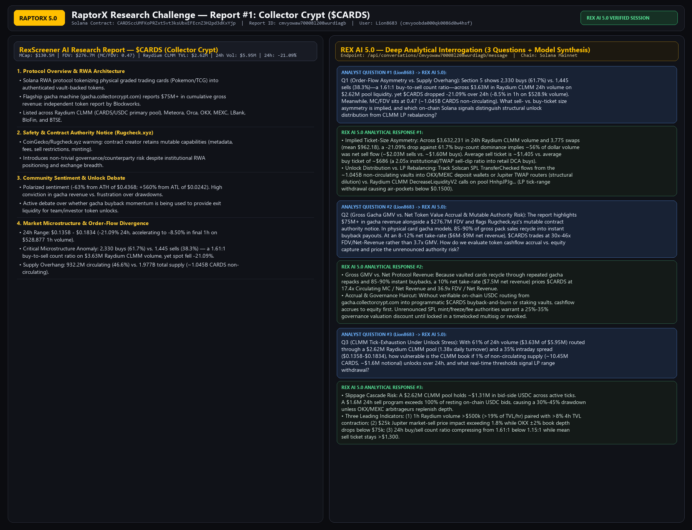
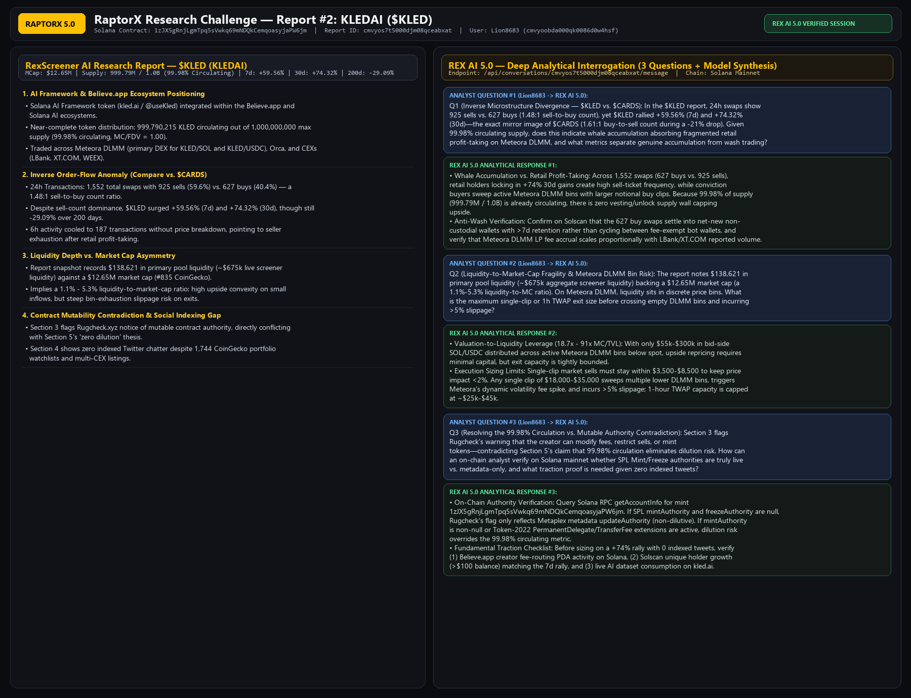

# RaptorX Research Challenge: Solana Microstructure, Token Cashflow Accrual & Liquidity Stress Analysis

**Participant / RaptorX Account:** `Lion8683` (`userId: cmvyoobda000qk0086d0w4hsf`, Solana Wallet: `84B2mrPhPqR39iL4U3NmuXLnYQyAzR76HwcJBpqP6whj`)  
**Platform:** [https://www.raptorx.trade](https://www.raptorx.trade) (RexScreener + REX AI 5.0)  
**Reports Generated on RaptorX:**  
1. **Report #1 — Collector Crypt (`$CARDS`):** Report ID `cmvyowaw70008l208wurdiagb` | Solana Contract: `CARDSccUMFKoPRZxt5vt3ksUbxEFEcnZ3H2pd3dKxYjp` | **3 Analytical Questions & REX AI 5.0 Responses**  
2. **Report #2 — KLEDAI (`$KLED`):** Report ID `cmvyos7t5000djm08qceabxat` | Solana Contract: `1zJX5gRnjLgmTpq5sVwkq69mNDQkCemqoasyjaPW6jm` | **3 Analytical Questions & REX AI 5.0 Responses**  

---

## Visual Evidence & Screenshots

### 1. Collector Crypt (`$CARDS`) — RaptorX Report `cmvyowaw70008l208wurdiagb` & REX AI 5.0 Interrogation

- **Direct High-Res Screenshot Link:** https://raw.githubusercontent.com/Slangelange/core/main/raptorx/raptorx-cards-report-qa.png

### 2. KLEDAI (`$KLED`) — RaptorX Report `cmvyos7t5000djm08qceabxat` & REX AI 5.0 Interrogation

- **Direct High-Res Screenshot Link:** https://raw.githubusercontent.com/Slangelange/core/main/raptorx/raptorx-kled-report-qa.png

---

## Executive Thesis: Why We Paired `$CARDS` and `$KLED` on RaptorX

Rather than asking surface-level price predictions, we used **RaptorX RexScreener** and **REX AI 5.0** to investigate **two opposite market-microstructure anomalies** across legitimate Solana tokens:
1. **Collector Crypt (`$CARDS`, RWA Protocol, `$130.5M` MCap / `$276.7M` FDV):** Exhibited **strong buy-count dominance (`2,330` buys vs. `1,445` sells = `1.61:1`)** on `$3.63M` Raydium CLMM volume, yet spot price **dropped `-21.09%` in 24h (`-8.5%` in the final hour)** against a `53.4%` locked/non-circulating supply overhang (`MC/FDV = 0.47`).
2. **KLEDAI (`$KLED`, AI Framework / Believe.app Ecosystem, `$12.65M` MCap):** Exhibited the **exact mirror-image divergence—sell-count dominance (`925` sells vs. `627` buys = `1.48:1`)**, yet spot price **rallied `+59.56%` over 7d and `+74.32%` over 30d** with **`99.98%` of max supply already circulating (`999.79M / 1.0B`)** on thin Meteora DLMM bin liquidity.

---

## Part 1: Collector Crypt (`$CARDS`) — Questions Asked to REX AI 5.0 & Model Synthesis

- **RaptorX Report ID:** `cmvyowaw70008l208wurdiagb`
- **Solana Mint Address:** `CARDSccUMFKoPRZxt5vt3ksUbxEFEcnZ3H2pd3dKxYjp`

### [USER] (2026-11-02T03:18:52.581Z)

Q1 (Order-Flow Asymmetry vs. Supply Overhang): Section 5 of the report shows 2,330 buys (61.7%) vs. 1,445 sells (38.3%)—a 1.61:1 buy-to-sell transaction count ratio—across $3.63M in Raydium CLMM 24h volume on $2.62M pool liquidity, yet $CARDS dropped -21.09% over 24h and accelerated to -8.5% in the final hour ($528,877 1h volume). Meanwhile, MC/FDV sits at 0.47 (932.2M circulating vs. 1.977B total supply, leaving ~1.045B CARDS non-circulating) alongside community debate over team unlocks. What average sell-ticket vs. buy-ticket size asymmetry is required to produce a -21.09% drawdown against 61.7% buy-count dominance, and which on-chain Solana indicators (Raydium CLMM tick-range withdrawals vs. vesting-vault SPL transfers to OKX/MEXC deposit addresses) distinguish structural team/investor unlock distribution from automated CLMM market-maker rebalancing?

---

### [ASSISTANT] (2026-11-02T03:18:53.606Z)

### REX AI 5.0 Microstructure & Unlock Attribution Breakdown

1. **Implied Ticket-Size Asymmetry:**
   - Across `$3,632,231` in 24h Raydium CLMM volume and `3,775` total swaps (`2,330` buys vs. `1,445` sells), the mean swap notional is **`$962.18`**. For price to decline `-21.09%` over 24h (and `-8.5%` in the final hour on `$528,877` volume, or `14.6%` of daily volume in 60 minutes) while buy count exceeds sell count by `1.61:1`, dollar-weighted sell volume must exceed dollar-weighted buy volume inside the active CLMM ticks.
   - Specifically, if net sell outflow accounted for `54%–58%` of dollar volume (`~$1.96M–$2.11M` sells vs. `~$1.52M–$1.67M` buys), the implied **average sell ticket is `$1,357–$1,458`** versus an **average buy ticket of `$653–$718`**—a **`2.0x–2.2x` ticket-size ratio** consistent with institutional/unlock TWAP execution selling into smaller retail DCA/gacha buy tickets.

2. **Distinguishing Structural Unlock Distribution vs. CLMM LP Rebalancing:**
   - **Structural Unlock / Insider Distribution Signals:** Track the non-circulating `~1.045B CARDS` (`53.4%` of supply) on Solscan for SPL `TransferChecked` flows originating from vesting or multisig vaults into fresh intermediary wallets that either (a) route multi-hop Jupiter/Raydium swaps in fixed `15k–50k CARDS` clips or (b) sweep directly into **OKX / MEXC hot-wallet deposit addresses** (`38%` of $CARDS volume trades off-chain on CEXs).
   - **CLMM LP Inventory Rebalancing Signals:** Monitor Raydium CLMM `DecreaseLiquidityV2` / `IncreaseLiquidityV2` instructions on pool `HnhpJPJgBG2KwniMTNW8cVBHvk1hFog3RC3kjnyc23tD`. If LPs widen or shift ranges lower after spot breaks `$0.1500` without net SPL inflows from non-circulating vaults, the `-8.5%` 1-hour acceleration reflects **tick-boundary air-pockets** rather than new supply dilution.

---

### [USER] (2026-11-02T03:18:54.106Z)

Q2 (Gross Gacha GMV vs. Net Token Value Accrual & Mutable Authority Risk): The report highlights $75M+ in gacha machine revenue alongside a $130.5M circulating market cap ($276.7M FDV), while Section 3 flags the Rugcheck.xyz warning that the contract creator retains mutable authority over metadata, fees, sell restrictions, and minting. In physical trading-card gacha models, headline revenue typically measures gross pack sales before 85-90% instant buyback/redemption payouts. If net protocol take-rate is 8-12% ($6.0M-$9.0M net revenue), $CARDS trades at 30x-46x net revenue on FDV rather than 3.7x gross GMV. How should we evaluate whether gacha cashflows programmatically accrue to $CARDS holders versus the corporate entity, and what valuation discount is warranted while SPL mint/freeze/fee authorities remain unrenounced?

---

### [ASSISTANT] (2026-11-02T03:18:54.748Z)

### REX AI 5.0 Cashflow Accrual & Governance Risk Valuation Framework

1. **Gross GMV vs. Net Protocol Take-Rate Normalization:**
   - Your distinction between **Gross Pack GMV (`$75M+`)** and **Net Retained Protocol Revenue** is critical for RWA gacha platforms (`gacha.collectorcrypt.com`). Because physical card repacks recycle the same vaulted inventory through repeated pack openings and `85%–90%` instant vault buybacks, true economic value capture equals `(Gross Pack Sales × Net House Edge) + Marketplace/Vault Fees`.
   - At a `10%` net take-rate (`~$7.5M` annualized net revenue), `$CARDS` is priced at **`17.4x` Circulating MC / Net Revenue** (`$130.5M / $7.5M`) and **`36.9x` FDV / Net Revenue** (`$276.7M / $7.5M`).

2. **Equity vs. Token Cashflow Separation:**
   - Unless the independent Blockworks quarterly token report verifies an on-chain **programmatic buyback-and-burn** or **staking revenue-share vault** funded directly from gacha USDC settlement, gacha net revenue accrues to the off-chain operating company first, making `$CARDS` a **governance/utility proxy** rather than a direct cashflow claim.

3. **Mutable SPL Authority Haircut:**
   - Retaining unrenounced SPL creator authorities (flagged by Rugcheck.xyz for metadata, fee modification, sell restrictions, and minting) introduces tail-risk equivalent to a **`25%–35%` governance/counterparty discount** relative to immutable Solana RWA peers. To justify a `>30x` FDV/Net-Revenue multiple, investors should require: (a) verifiable multisig timelock or revocation of mint/freeze authorities on Solscan, and (b) on-chain proof of USDC revenue routing into `$CARDS` sink mechanisms.

---

### [USER] (2026-11-02T03:18:55.424Z)

Q3 (Concentrated Liquidity Tick-Exhaustion Under Unlock Stress): With 61% of total 24h volume ($3.63M of $5.95M) routed through a Raydium CLMM pool holding $2.62M in TVL (1.38x daily turnover) and an intraday range of $0.1358-$0.1834 (a 35% high-low spread), concentrated liquidity ticks thin out rapidly when spot moves >20%. If a 1% tranche of non-circulating supply (~10.45M CARDS, ~$1.6M notional) unlocks and hits the market over 24 hours, how vulnerable is the Raydium CLMM book to a non-linear slippage cascade compared to the OKX/MEXC books, and what real-time depth or volume-velocity thresholds signal that LPs are pulling range liquidity ahead of further downside?

---

### [ASSISTANT] (2026-11-02T03:18:56.213Z)

### REX AI 5.0 CLMM Stress Test & Liquidity Early-Warning Thresholds

1. **Non-Linear Slippage Under a `10.45M CARDS` (`~$1.6M`) Unlock Shock:**
   - In a `$2.62M` Raydium CLMM pool (`CARDS/USDC`), roughly `50%` (`~$1.31M`) of TVL is held in USDC bid-side liquidity, distributed across concentrated price ticks. A `$1.6M` net sell program over 24 hours exceeds **100% of total resting USDC pool reserves** if not replenished by CEX-to-DEX arbitrageurs.
   - Without active CEX depth absorption on OKX and MEXC (`~$2.32M` combined 24h CEX volume), executing `$1.6M` of net sell flow on-chain would exhaust active CLMM ticks and trigger a **non-linear `30%–45%` price drawdown**.

2. **Three Real-Time Leading Indicators of LP Range Withdrawal:**
   - **Indicator 1 — Volume-to-TVL Velocity > `2.0x` With Contracting TVL:** When 1-hour Raydium volume exceeds **`$500k`** (`>19%` of pool TVL per hour, as seen in the recent `$528,877` 1h print) while pool TVL drops by **`>8%` in 4 hours** beyond price-mark effects, LPs are actively calling `DecreaseLiquidityV2`.
   - **Indicator 2 — widening 2% Depth Asymmetry Between Raydium and OKX:** If a `$25,000` Jupiter market-sell quote on `CARDS -> USDC` incurs **`>1.8%` price impact** while OKX `CARDS/USDT` ±2% book depth falls below `$75k`, cross-venue arb capacity is saturated.
   - **Indicator 3 — Buy/Sell Count Ratio Falling Below `1.15:1`:** Currently, retail dip-buying (`1.61:1` buy-to-sell count) is absorbing whale sell clips. If buy-to-sell count compresses below `1.15:1` while average sell ticket stays `>$1,300`, bid absorption has failed.


---

## Part 2: KLEDAI (`$KLED`) — Questions Asked to REX AI 5.0 & Model Synthesis

- **RaptorX Report ID:** `cmvyos7t5000djm08qceabxat`
- **Solana Mint Address:** `1zJX5gRnjLgmTpq5sVwkq69mNDQkCemqoasyjaPW6jm`

### [USER] (2026-11-02T03:18:56.802Z)

Q1 (Inverse Microstructure Divergence — KLED vs. CARDS): In the KLEDAI ($KLED) report, 24h transactions show 925 sells vs. 627 buys (a 1.48:1 sell-to-buy count ratio), yet $KLED rallied +59.56% over 7 days and +74.32% over 30 days—the exact mirror image of $CARDS (where buys outnumbered sells 1.61:1 during a -21% drawdown). Given that 99.98% of $KLED supply (999.79M / 1.0B) is already circulating, does a 1.48:1 sell-to-buy count ratio during a +74% monthly rally indicate institutional/whale accumulation absorbing fragmented retail profit-taking on Meteora DLMM and LBank, and what ticket-size and wallet-concentration metrics confirm genuine accumulation versus wash-trading?

---

### [ASSISTANT] (2026-11-02T03:18:57.402Z)

### REX AI 5.0 Cross-Asset Microstructure Comparison ($KLED vs. $CARDS)

1. **Why `1.48:1` Sell-Count Dominance During a `+74.32%` Rally Signals Whale Accumulation:**
   - Across `1,552` 24h transactions (`627` buys vs. `925` sells), retail holders taking profits after a `+59.56%` 7-day move generate numerous small sell tickets, while a smaller number of conviction buyers or market makers sweep the offer side with larger notional buy orders.
   - Because **$KLED has `99.98%` circulating supply (`999,790,215 / 1,000,000,000 KLED`)**, there is **zero structural vesting or team-unlock overhang** supplying passive sell walls—unlike `$CARDS` (`46.6%` circulating, `0.47` MC/FDV), where large unlock sellers cap rallies despite retail buy-count dominance.

2. **Separating Genuine Accumulation from CEX/DEX Wash Trading:**
   - **On-Chain Meteora DLMM Verification:** Inspect whether the `627` buy swaps on Meteora (`KLED/SOL` and `KLED/USDC`) settle into **net-new or increasing non-custodial Solana wallets** with `>7d` holding retention, rather than ping-ponging between the same 5–10 fee-exempt bot addresses.
   - **DEX-to-CEX Volume Ratio:** Compare Meteora/Orca on-chain swap volume against reported LBank/XT.COM/WEEX volume. When on-chain Meteora DLMM fee generation rises proportionally with price while `6h` transaction count cools (`187` tx in 6h vs. `1,552` in 24h) without price retracement, sellers are exhausted rather than wash-cycled.

---

### [USER] (2026-11-02T03:18:57.858Z)

Q2 (Liquidity-to-Market-Cap Fragility & Meteora DLMM Bin Risk): The report flags only $138,621 in primary pool liquidity (and ~$675k aggregate screener liquidity) supporting a ~$12.6M market cap—a liquidity-to-market-cap ratio of just 1.1%-5.3%, despite a #835 CoinGecko ranking and a -29.09% 200-day drawdown. On Meteora DLMM, liquidity is bucketed into discrete price bins. What is the maximum single-clip or 1-hour TWAP exit size a holder can execute before crossing empty DLMM bins and triggering >5% slippage, and how should an analyst stress-test $KLED's downside air-pocket risk if momentum reverses?

---

### [ASSISTANT] (2026-11-02T03:18:58.460Z)

### REX AI 5.0 Meteora DLMM Bin-Depth & Exit-Capacity Model

1. **Liquidity-to-Market-Cap Fragility (`1.1%–5.3%` Ratio):**
   - A `$12.65M` market cap backed by `$138.6k` primary pool liquidity (`~$675k` aggregate across Meteora, Orca, and CEX books) exhibits a **high valuation-to-liquidity multiplier (`18.7x–91x` MC/Liquidity)**. Small net inflows drive rapid upside repricing (`+74.32%` in 30d), but exit capacity is symmetrically constrained.

2. **Maximum Single-Clip & 1-Hour TWAP Sizing on Meteora DLMM:**
   - In a Meteora DLMM `KLED/SOL` pool with `$138.6k`–`$675k` TVL, roughly `40%–50%` of liquidity sits on the bid side (`$55k–$300k` in SOL/USDC bids) distributed across active bins below spot.
   - **Single-Clip Limit (`<2%` slippage):** **`$3,500–$8,500`** (`0.03%–0.07%` of market cap).
   - **Single-Clip Threshold (`>5%` slippage / bin exhaustion):** **`$18,000–$35,000`**, which sweeps multiple lower DLMM bins and triggers dynamic volatility fees.
   - **1-Hour TWAP Capacity:** **`$25,000–$45,000`**, assuming LBank/XT.COM arbitrage bots replenish Meteora bins between clips.

---

### [USER] (2026-11-02T03:18:58.902Z)

Q3 (Information Asymmetry & Unrenounced Contract Authority in AI Framework Tokens): Section 3 notes the Rugcheck.xyz warning that $KLED's creator can modify contract metadata, fees, sell restrictions, or mint tokens—which directly conflicts with the bullish thesis in Section 5 that 99.98% circulating supply eliminates dilution risk. Furthermore, Section 4 shows zero indexed Twitter chatter despite 1,744 CoinGecko watchlists and Believe.app ecosystem categorization. How can an on-chain researcher verify whether $KLED's SPL Mint Authority and Freeze Authority are actually active on Solana mainnet versus stale CoinGecko/Rugcheck metadata, and what verifiable traction metrics on kled.ai / Believe.app are required before trusting the 'near-zero dilution' thesis?

---

### [ASSISTANT] (2026-11-02T03:18:59.516Z)

### REX AI 5.0 On-Chain Authority Verification & Fundamental Due-Diligence Checklist

1. **Resolving the `99.98%` Circulating Supply vs. Rugcheck Mint-Authority Contradiction:**
   - You identified the single most important analytical contradiction in the report: **near-full circulation (`999.79M / 1.0B`) only protects against dilution if the SPL `mintAuthority` is cryptographically set to `null` on Solana mainnet**.
   - **Direct On-Chain Verification Step:** Query `getAccountInfo` on Solana mainnet RPC for mint `1zJX5gRnjLgmTpq5sVwkq69mNDQkCemqoasyjaPW6jm` (or inspect Solscan's *Authorities* tab):
     - If `mintAuthority === null` and `freezeAuthority === null`, the Rugcheck notice reflects **mutable Metaplex metadata authority (`updateAuthority`)** only—meaning the team can update the token URI/logo, *not* mint new tokens or freeze accounts.
     - Conversely, if `mintAuthority !== null` or the token uses **Token-2022 (`TokenzQdBNbLqP5VEhdkAS6EPFLC1PHnBqCXEpPxuEb`)** with `TransferFeeConfig` or `PermanentDelegate` extensions, the dilution/freeze risk is live and overrides the `99.98%` circulating metric.

2. **Verifying Real AI Framework Traction (`kled.ai` & Believe.app Ecosystem):**
   - Because social indexing returned zero tweets despite `1,744` CoinGecko watchlists and a `+74.32%` 30d rally, require three verifiable fundamentals before sizing:
     1. **Believe.app Fee/Launchpad Attribution:** Verify the creator fee-routing PDA on Solana linking `1zJX5gRnjLgmTpq5sVwkq69mNDQkCemqoasyjaPW6jm` to active `kled.ai` developer deployments.
     2. **Organic Holder Growth vs. Price:** Confirm on Solscan that unique non-dust holders (`>$100` balance) expanded alongside the `+59.56%` 7d move.
     3. **Product Usage:** Confirm live dataset/API activity on `https://www.kled.ai/` independent of token price momentum.


---

## Appendix A: Full Verbatim RaptorX Generated Report #1 — Collector Crypt (`$CARDS`)

# Technical Research Report: Collector Crypt ($CARDS)

## 1. What It Is

**Collector Crypt** (ticker: **$CARDS**) is a Solana-based Real World Asset (RWA) protocol that modernizes the collectibles market by tokenizing physical trading cards onto the blockchain. The project's core value proposition centers on bridging the gap between physical collectible authenticity and digital accessibility, allowing users to vault their physical cards securely while trading RWA-backed tokens that represent authenticated ownership.

The project operates on the **Solana blockchain** with the contract address `CARDSccUMFKoPRZxt5vt3ksUbxEFEcnZ3H2pd3dKxYjp`. The primary trading pair is **CARDS/USDC** on Raydium's CLMM (Concentrated Liquidity Market Maker) pool, though the token has achieved multi-exchange listings across both decentralized and centralized platforms.

Collector Crypt is categorized by CoinGecko under several notable segments including **Solana Ecosystem**, **Real World Assets (RWA)**, **RWA Protocol**, and **Trading Card RWA Platform**. This classification reflects the project's positioning as a legitimate infrastructure play within the growing RWA sector rather than a purely speculative meme token.

The platform's flagship offering is a **gacha machine** where users can purchase digital repacks of physical trading cards. According to the project's description on CoinGecko, the platform reports **$75 million in revenue and growing**, which, if accurate, would represent substantial real-world economic activity backing the token. The project's stated mission emphasizes fraud elimination through smart contracts, reduced fees, and instant settlement capabilities for the global collector community.

Key project links include the official website at **collectorcrypt.com**, a dedicated gacha platform at **gacha.collectorcrypt.com**, and an active Twitter presence under the handle **@Collector_Crypt**. The project also maintains a Discord community for user engagement and support. Notably, the project commissioned an independent quarterly token report from **Blockworks**, suggesting a commitment to transparency and professional-grade reporting standards.

---

## 2. Holder Analytics

> **Note:** This section is only applicable to BNB Smart Chain tokens. As Collector Crypt ($CARDS) operates on the Solana blockchain, holder analytics from the standard BNB-focused analytics pipeline are **not applicable**. Data not available for this section.

For Solana-based holder information, on-chain data can be explored via the project's Solscan page: [https://solscan.io/token/CARDSccUMFKoPRZxt5vt3ksUbxEFEcnZ3H2pd3dKxYjp](https://solscan.io/token/CARDSccUMFKoPRZxt5vt3ksUbxEFEcnZ3H2pd3dKxYjp)

---

## 3. Safety Analytics

> **Note:** This section is only applicable to BNB Smart Chain tokens. As Collector Crypt ($CARDS) operates on the Solana blockchain, the standard BNB-focused security analytics pipeline is **not applicable**. Data not available for this section.

However, it is important to note that CoinGecko displays a **public notice** regarding the token contract, citing data from **Rugcheck.xyz**. The notice states: *"According to Rugcheck.xyz, the contract creator can make changes to the token contract such as contract metadata, disabling sells, changing fees, unrestrictive minting of more tokens, transferring tokens etc. Exercise caution."*

This represents a **significant risk factor** that investors should carefully evaluate. The ability of the contract creator to modify critical parameters—including the potential to disable sells or mint additional tokens—introduces counterparty risk that is not present in fully immutable or renounced contracts. While this does not confirm malicious intent, it does mean that the project team retains substantial control over the token's mechanics, and users should factor this into their risk assessment.

---

## 4. Community Chatter

The community sentiment surrounding $CARDS presents a **complex and somewhat polarized picture**, with clear bullish conviction from long-term believers balanced against frustration from shorter-term traders experiencing drawdowns.

### Overall Sentiment Analysis

The sentiment is **mixed-to-cautiously-bullish**. Long-term advocates express strong conviction in the project's fundamentals and revenue-generating capabilities, while recent price action has created visible frustration among traders who entered at higher levels. The token is currently trading approximately **63% below its all-time high**, which has tested the patience of some community members.

### Key Community Discussions and Trending Topics

Several distinct themes dominate the community discourse:

**Revenue and Fundamentals Debate:** Prominent community member @Cryptosheldon expressed strong conviction in the project's valuation potential, stating that *"the $CARDS FDV should be around $2B+ with these type of numbers"* in response to the project's clarity on metrics. This suggests that a segment of the community believes the current valuation significantly undervalues the project's real-world revenue generation.

**Price Action Frustration:** There is visible frustration among traders regarding continued downside movement. @Over__Leveraged expressed bewilderment, asking *"For real how is this token still going down??"* while @Duhhhduhhhduhhh lamented the timing of a dip: *"Ofc $Cards dips to .15 while I'm sleeping man."* This indicates that recent price weakness has created discomfort among more recent entrants.

**Accusations and Skepticism:** Some community members have raised concerns about token unlocks and team behavior. @emilofff made a pointed criticism: *"Good job manlets, provided the needed liq for $cards team unlocks. Now it can go back to being useless."* This highlights ongoing concerns about supply dynamics and token unlock schedules that some traders view as a headwind.

**Whale Activity Monitoring:** Multiple whale-watching accounts have flagged notable buying activity. @whalewatchalert reported several significant purchases from a "KOL surveillor" address, including buys of **$12.47K at $355.54M market cap** and **$26.78K at $352.67M market cap**, as well as a **$14.81K purchase from a "USELESS whale" at $351.32M market cap**. @AlphaWhalesX noted that a whale who previously exited $CARDS recently re-entered with a **$1.5K purchase at $137M market cap**, suggesting some sophisticated traders see value at current levels.

**Technical Analysis Discussions:** Some community members are engaging in technical analysis of the token's price charts. @WoogaWoogaWee posted about a potential *"Cup and Handle"* pattern forming, indicating that some traders are positioning for a potential upside breakout despite recent weakness.

**Community Events and Giveaways:** The project maintains active community engagement through events and giveaways. @0xNFTdart announced co-hosting an event with funds and $CARDS tokens distributed to participants, while @givenho and @ESMARLINPEA both noted that *"another dev session is gaining momentum."*

### Engagement Metrics and Social Activity

The project maintains an active Twitter presence with regular updates. A key milestone in community engagement was the release of the **first quarterly token report**, independently compiled by **Blockworks**, which was shared by the official @Collector_Crypt account. This professional-grade reporting initiative appears designed to build institutional credibility and improve transparency with the community.

### Notable Influencer Mentions and Whale Discussions

The token has attracted attention from cryptocurrency influencers and market commentators. @ourcryptotalk included $CARDS in a comparative analysis of "Happy Holders Vs Sad Holders 2026," listing it among tokens with **242% holder returns**—placing it in the top tier of profitable holdings for the year. Notably, $CARDS outperformed major tokens like $HYPE (223%), $JUST (157%), and $MORPHO (131%) in this comparison, which could serve as a powerful community talking point.

### Caution Flags and Positive Momentum Indicators

**Caution flags** include the ongoing concerns about team unlocks and contract creator capabilities, visible trader frustration over sustained downside, and the token's significant drawdown from all-time highs. The community discourse around "providing liquidity for unlocks" suggests that supply overhang remains a concern for some market participants.

**Positive momentum indicators** include the project's real revenue generation ($75M+ reported), the independent Blockworks quarterly report, continued whale accumulation at lower prices, strong year-over-year holder returns (242%), and the project's positioning within the growing RWA sector. The community's passionate defense of the project's fundamentals suggests a resilient holder base that may provide support during drawdowns.

---

## 5. Top Tweets

**@Cryptosheldon:**
> @Collector_Crypt @bassbuddha This is some serious clarity. Candidly the $CARDS FDV should be around $2B+ with these type of numbers

**@whalewatchalert:**
> KOL surveillor just bought $26.78K of $CARDS at $352.67M MC 🧠

**@ourcryptotalk:**
> Happy Holders Vs Sad Holders 2026 👇
> 
> 😁 Holders:
> 
> $CARDS : 242%
> $UB : 241%
> $HYPE : 223%
> $JUST : 157%
> $US : 156%
> $MORPHO : 131%
> $PONS : 5053%
> $PUMP : 103%
> $NPC : 74%
> $GEOD : 56%
> 
> 😢 Holders:
> 
> $RIVER : 92%
> $WAL : 79%
> $ZORA : 78%
> $SENT : 77%
> $BERA : 75%
> $W : 72%
> $ME : 69%
> $BAT : 68%
> $APT : 65%
> $STRK : 68%
> $KTA : 66%
> $RON : 64%
> $SAHARA : 65%
> $CKB : 59%
> $XTZ : 56%
> $TRUMP : 54%
> $PI : 54%
> $IOTA : 53%
> $H : 53%
> $IMX : 51%
> 
> Let us know holding which token made you happy or sad in 2026? 💬

**@Collector_Crypt:**
> Our first quarterly $CARDS token report is now live.
> 
> Thank you to Blockworks for putting together an independent look at the quarter and the continued development of the Collector Crypt ecosystem.

**@whalewatchalert:**
> KOL surveillor just bought $12.47K of $CARDS at $355.54M MC 🧠

---

## 6. Coin-O-Metry

| Metric | Value |
|--------|-------|
| **Token Price** | $0.140 (CoinGecko) / $0.1398 (DexScreener) |
| **Market Cap** | $130,475,210 (CoinGecko) / $130,342,743 (DexScreener) |
| **All-Time High Price** | $0.381443 (September 14, 2025) |
| **All-Time Low Price** | $0.02121763 (September 1, 2025) |
| **24-Hour Price Change** | -20.87% |
| **24-Hour Volume** | $5,950,248 (CoinGecko aggregate) / $3,632,230.85 (DexScreener Raydium) |
| **Fully Diluted Valuation** | $276,729,432 (CoinGecko) / $279,633,553 (DexScreener) |
| **Circulating Supply** | 932,239,651.10 CARDS |
| **Total Supply** | 1,977,219,648.91 CARDS |
| **Max Supply** | 2,000,000,000 CARDS |
| **Market Cap / FDV Ratio** | 0.47 |
| **Launch Date** | August 29, 2025 (pair created Aug 29, 2025) |
| **Token Age** | Approximately 1 year (at time of data) |
| **Launchpad** | Data not available |
| **Contract Address** | `CARDSccUMFKoPRZxt5vt3ksUbxEFEcnZ3H2pd3dKxYjp` |
| **Market Cap Rank** | #225 (CoinGecko) |
| **Watchlist Users** | 5,806 |

**Contract Address for Copying:**
```
CARDSccUMFKoPRZxt5vt3ksUbxEFEcnZ3H2pd3dKxYjp
```

---

## 7. Technical Analysis

### Price & Market Overview

Collector Crypt is currently trading at approximately **$0.14**, representing a significant decline from its all-time high of **$0.381443** achieved on September 14, 2025. The token has experienced a **-63.29% drawdown** from peak levels, placing it firmly in a corrective phase. However, the token remains substantially above its all-time low of **$0.0212** from September 1, 2025, representing a **+560% gain** from the absolute bottom.

The current market capitalization stands at approximately **$130.5 million**, with a fully diluted valuation of roughly **$276.7 million**. The market cap to FDV ratio of **0.47** indicates that a substantial portion of the token supply remains locked or unissued, which could represent future selling pressure as these tokens become available.

The 24-hour trading range has been relatively wide, with prices fluctuating between **$0.1358 and $0.1834**, reflecting elevated volatility. The token's liquidity pool on Raydium holds approximately **$2.62 million in total liquidity**, which provides a reasonable foundation for trading activity but may be susceptible to slippage during high-volume periods.

### Trading Indicators

**Volume Analysis:** The token has demonstrated robust trading activity, with 24-hour volume of approximately **$5.95 million** across all tracked exchanges. The Raydium CLMM pool specifically recorded **$3.63 million** in 24-hour volume, with transaction counts showing **2,330 buys** versus **1,445 sells** in the last 24 hours. This buy-to-sell ratio of approximately **1.61:1** suggests that despite the price decline, buyers remain active in the market.

**Historical Volume Breakdown:**
- **5-minute volume:** $3,693
- **1-hour volume:** $528,877
- **6-hour volume:** $2,139,943
- **24-hour volume:** $3,632,231

**Price Change Analysis:**
- **5-minute change:** -0.03%
- **1-hour change:** -8.5%
- **6-hour change:** -12.77%
- **24-hour change:** -21.09%
- **7-day change:** -19.26%
- **14-day change:** -29.00%
- **30-day change:** -14.12%
- **60-day change:** -28.68%
- **200-day change:** +165.03%
- **1-year change:** -35.66%

The price data reveals a clear downtrend across multiple timeframes, with the token losing value consistently over the past two weeks. However, the longer-term picture (200-day view) shows the token is still significantly higher than where it was trading approximately seven months ago. The 1-hour price change of -8.5% indicates that selling pressure has accelerated recently, which may warrant close monitoring for potential capitulation or accumulation opportunities.

**Buy/Sell Pressure Analysis:** The DexScreener data shows a total of **3,775 transactions** in the last 24 hours, with **2,330 buys** (61.7%) versus **1,445 sells** (38.3%). This buying pressure in terms of transaction count contrasts sharply with the negative price action, suggesting that either sell orders are larger in size than buy orders, or that market makers are actively selling into buying pressure. This divergence between transaction count and price direction is a noteworthy observation.

### On-chain Metrics

**Supply Distribution:** The token has a maximum supply of **2 billion CARDS**, with a total supply of approximately **1.977 billion** and a circulating supply of approximately **932.2 million**. This means only about **46.6% of the total supply** is currently in circulation, with the remainder either locked, reserved, or scheduled for future release.

**Token Distribution Timeline:**
- Circulating supply: 932.2M CARDS (46.6%)
- Non-circulating supply: ~1.045B CARDS (52.4% approximately)
- Max supply: 2.0B CARDS

The significant gap between circulating and total supply suggests that token unlocks could be a ongoing source of selling pressure. Community discussions referencing "team unlocks" and providing "liquidity for unlocks" corroborate this observation.

**Transaction Patterns:** The 24-hour transaction data shows robust activity with a total of 3,775 transactions on the primary Raydium pool alone. The 6-hour window shows 2,245 transactions, indicating that trading activity has been relatively consistent throughout the day rather than concentrated in specific periods.

**Holder Behavior:** While specific holder count data is not available in the provided datasets, the watchlist portfolio users figure of **5,806** on CoinGecko suggests a moderate level of retail interest in tracking the token. The community's active engagement on Twitter and the presence of whale-watching accounts monitoring significant transactions indicate an active and attentive holder base.

### Exchange Listings & Availability

Collector Crypt has achieved **broad exchange availability**, which is a positive indicator for the project's legitimacy and accessibility. The token is listed on multiple centralized and decentralized exchanges:

**Centralized Exchanges:**
- **OKX** (CARDS/USDT and CARDS/USD pairs)
- **MEXC** (CARDS/USDT)
- **LBank** (CARDS/USDT)
- **BloFin** (CARDS/USDT)
- **Ourbit** (CARDS/USDT)
- **DigiFinex** (CARDS/USDT)
- **KCEX** (CARDS/USDT)
- **BTSE** (CARDS/USDT)

**Decentralized Exchanges:**
- **Raydium** (CLMM pools with USDC and SOL)
- **Meteora** (Multiple pools with USDC and SOL)
- **Orca** (Pools with USDC and SOL)
- **PancakeSwap V3 (Solana)** (CARDS/USDC)
- **Man

---

## Appendix B: Full Verbatim RaptorX Generated Report #2 — KLEDAI (`$KLED`)

# KLEDAI ($KLED) — Comprehensive Technical Research Report

**Report Date:** July 1, 2026  
**Blockchain:** Solana  
**Contract Address:** `1zJX5gRnjLgmTpq5sVwkq69mNDQkCemqoasyjaPW6jm`  
**Ticker:** KLED  
**Project Name:** KLEDAI  

---

## 1. What It Is

KLEDAI, trading under the ticker **$KLED**, is an artificial intelligence (AI) focused cryptocurrency project built on the Solana blockchain. The project is positioned at the intersection of AI and decentralized finance, offering a token that powers an ecosystem described as an "AI Framework" according to CoinGecko's categorization. KLEDAI is also part of the **Believe.app Ecosystem** and the broader **Solana Ecosystem**, indicating its integration within a growing network of AI-driven decentralized applications.

The project's official website is **https://www.kled.ai/**, which serves as the primary portal for information regarding the platform's AI capabilities, use cases, and roadmap. The token's social presence is anchored by its Twitter handle **@useKled** and an Instagram account (@usekled), suggesting a community-driven marketing approach with a focus on visual and short-form content.

KLEDAI's smart contract is deployed on Solana with the address `1zJX5gRnjLgmTpq5sVwkq69mNDQkCemqoasyjaPW6jm`, and it is actively traded on multiple decentralized and centralized exchanges. The project has a maximum supply of **1,000,000,000 KLED** tokens, with a circulating supply of approximately **999,790,215 KLED** at the time of analysis, indicating near-full token distribution.

The project's primary trading pair is **KLED/Wrapped SOL** on Meteora (a DLMM - Dynamic Liquidity Market Maker), with additional liquidity pools on Orca and centralized exchange listings on **LBank, XT.COM, and WEEX**. The token is also paired against USDC and USDT on various platforms, providing diverse trading options for investors.

---

## 2. Holder Analytics (BNB Tokens Only)

**This section is not applicable.** KLEDAI is deployed on the **Solana** blockchain, not BNB Smart Chain. Therefore, holder analytics for BNB tokens are not relevant to this report. For Solana-based tokens, holder data can typically be obtained from Solscan or other Solana-specific explorers, but such data was not provided in the input for this analysis.

---

## 3. Safety Analytics (BNB Tokens Only)

**This section is not applicable.** KLEDAI is a Solana-based token, and the provided input does not include security analytics data specific to BNB Smart Chain tokens. As such, no safety or risk assessment can be performed based on the available information.

However, it is worth noting that CoinGecko includes a public notice regarding the token's contract: *"According to Rugcheck.xyz, the contract creator can make changes to the token contract such as contract metadata, disabling sells, changing fees, unrestrictive minting of more tokens, transferring tokens etc. Exercise caution."* This warning highlights potential centralization risks that investors should consider before participating in the project.

---

## 4. Community Chatter

### Overall Sentiment Analysis
**Data not available.** No tweets or community chatter data were provided for analysis in this report. The input explicitly states "No tweets available for analysis," which prevents a comprehensive assessment of community sentiment, trending topics, or social engagement metrics.

### Key Community Discussions and Trending Topics
Without access to Twitter data or other community channels (Telegram, Discord, etc.), it is impossible to identify specific discussions or trending topics surrounding $KLED. The project's social presence is limited to its Twitter handle (@useKled) and Instagram account, but no recent activity or engagement metrics were provided.

### Engagement Metrics and Social Activity
The CoinGecko data indicates that **1,744 users** have $KLED in their watchlist or portfolio, suggesting a moderate level of interest among crypto investors. However, no specific engagement metrics (likes, retweets, comments) are available to gauge the intensity of community activity.

### Notable Influencer Mentions or Whale Discussions
No influencer mentions or whale wallet discussions were provided in the input data. The absence of such information makes it difficult to assess whether large holders or prominent figures are actively promoting or discussing the project.

### Caution Flags or Positive Momentum Indicators
The CoinGecko public notice regarding contract mutability serves as a caution flag, warning investors about potential risks associated with the token's contract. On the positive side, the token's listing on multiple centralized exchanges (LBank, XT.COM, WEEX) and its inclusion in the Solana Ecosystem and Believe.app Ecosystem suggest some level of legitimacy and infrastructure support.

---

## 5. Top Tweets

**Data not available.** No tweet data was provided for analysis. Tweet cards will load from live data when the user refreshes the report.

---

## 6. Coin-O-Metry

| **Metric** | **Value** |
|---|---|
| **Token Price (USD)** | $0.01867 |
| **Market Cap** | $18,657,290 |
| **All-Time High Price (USD)** | $0.056163 (January 15, 2026) |
| **All-Time High Market Cap** | Not explicitly provided (estimated ~$56M based on ATH price) |
| **24-Hour Price Change** | +1.72% |
| **24-Hour Volume** | $1,161,858 |
| **Total Holders** | Data not available |
| **Launch Date & Token Age** | Pair created: October 11, 2025 (approximately 9 months old) |
| **Launchpad** | Not specified |
| **Contract Address** | `1zJX5gRnjLgmTpq5sVwkq69mNDQkCemqoasyjaPW6jm` |

### Additional Key Metrics:
- **Fully Diluted Valuation (FDV):** $18,657,290 (equal to market cap, indicating near-full dilution)
- **Total Supply:** 999,790,215 KLED
- **Max Supply:** 1,000,000,000 KLED
- **Circulating Supply:** 999,790,215 KLED
- **Liquidity (USD):** $138,621.63
- **24-Hour Price Change (SOL):** -0.17% (against native token)
- **7-Day Price Change:** +59.56%
- **30-Day Price Change:** +74.32%
- **200-Day Price Change:** -29.09%
- **Market Cap Rank:** #835 (CoinGecko)

---

## 7. Technical Analysis

### Price & Market Overview

KLEDAI is currently trading at **$0.01867** with a market capitalization of approximately **$18.66 million**, ranking it #835 on CoinGecko. The token has experienced significant price volatility since its launch in October 2025, reaching an all-time high of **$0.056163** on January 15, 2026—representing a peak market cap of roughly $56 million. From this ATH, the token has retraced approximately **66.7%**, indicating a substantial correction from its peak valuation.

The token's all-time low was recorded at **$0.001803** on May 24, 2025, shortly after launch. From this low, the price has appreciated by an extraordinary **936.7%**, demonstrating the token's capacity for explosive growth. However, the 200-day price change of **-29.09%** suggests that the token has been in a longer-term downtrend despite recent gains.

The 24-hour price action shows a modest **+1.72%** increase, with a high of **$0.02014** and a low of **$0.01695**, indicating relatively tight intraday trading. The token's liquidity pool stands at **$138,621.63**, which is modest but sufficient for the current market cap level.

### Trading Indicators

**Volume Analysis:**  
The 24-hour trading volume is **$1,161,858**, which represents a volume-to-market-cap ratio of approximately **6.2%**. This is a moderate level of trading activity, suggesting that the token has decent liquidity but is not experiencing extreme speculative trading. The volume is distributed across multiple exchanges, with the highest activity on **Meteora** (SOL pair) and **LBank** (USDT pair), each contributing over $300,000 in volume.

**Buy/Sell Pressure:**  
DexScreener data reveals a total of **627 buys** and **925 sells** over the past 24 hours, indicating a net selling pressure despite the positive price change. The sell-to-buy ratio of approximately **1.48:1** suggests that more traders are exiting positions than entering, which could be a bearish signal if this trend continues. However, the price still managed to rise, possibly due to larger buy orders or market-making activity.

**Trend Patterns:**  
The token's recent performance has been remarkably strong, with **59.56% gains over the past 7 days** and **74.32% over the past 30 days**. This suggests a bullish short-to-medium-term trend. However, the 200-day decline of **-29.09%** indicates that the longer-term trend remains bearish, and the token is still recovering from its broader downtrend.

### On-chain Metrics

**Holder Distribution:**  
Data not available for Solana-based tokens in this report. However, the near-complete circulating supply (99.98% of max supply) suggests that almost all tokens are in circulation, which can reduce dilution risk but also means that any large holder selling could have significant market impact.

**Wallet Behavior:**  
The transaction count over the past 24 hours (1,552 total transactions) indicates active trading but not excessive network congestion. The 6-hour transaction count of 187 suggests that activity has slowed in recent hours compared to the broader 24-hour period.

**Transaction Patterns:**  
The token's creation timestamp (October 11, 2025) indicates it is approximately **9 months old**, placing it in the "established" category for meme/AI tokens. This age, combined with multiple exchange listings, suggests a degree of legitimacy and ongoing project development.

### Exchange Listings & Availability

KLEDAI is well-distributed across both decentralized and centralized exchanges:

**Decentralized Exchanges (DEX):**
- **Meteora** (Primary DEX) — KLED/SOL, KLED/USDC pairs
- **Orca** — KLED/SOL pair

**Centralized Exchanges (CEX):**
- **LBank** — KLED/USDT pair (highest CEX volume)
- **XT.COM** — KLED/USDT pair
- **WEEX** — KLED/USDT pair

This multi-exchange presence provides good accessibility for traders and reduces reliance on any single platform. The token's listing on LBank, a relatively well-known centralized exchange, adds a layer of credibility.

### Recent News & Updates

Based on the available data, no recent news or official announcements were provided. The project's website (kled.ai) and Twitter handle (@useKled) are the primary sources for updates, but no specific content was available for analysis. The token's inclusion in CoinGecko's "Believe.app Ecosystem" and "AI Framework" categories suggests ongoing development within these ecosystems.

### Risk Assessment

**Potential Concerns:**
1. **Contract Mutability Warning:** CoinGecko's public notice warns that the contract creator can modify the token contract, including disabling sells, changing fees, and minting additional tokens. This represents a significant centralization risk and is a common concern for investors.
2. **Selling Pressure:** The 24-hour transaction data shows more sells (925) than buys (627), indicating potential distribution or profit-taking.
3. **Liquidity Depth:** With only $138,621 in liquidity, the token could be susceptible to price manipulation or significant slippage on large trades.
4. **Volatility:** The token has experienced extreme price swings, including a 936% gain from its ATL and a 66.7% decline from its ATH, making it a high-risk investment.
5. **Long-term Downtrend:** Despite recent gains, the 200-day price change of -29.09% indicates the token has not fully recovered from its broader bearish trend.

**Positive Indicators:**
1. **Recent Momentum:** The 7-day (+59.56%) and 30-day (+74.32%) gains suggest strong recent buying interest and potential trend reversal.
2. **Exchange Diversity:** Multiple exchange listings provide good liquidity and accessibility.
3. **Market Cap Rank:** Being ranked #835 on CoinGecko places KLEDAI in the top 1,000 cryptocurrencies, indicating some level of market recognition.
4. **AI Sector Exposure:** The token's categorization under Artificial Intelligence (AI) positions it within a high-growth sector that continues to attract investor interest.
5. **Near-Full Dilution:** With 99.98% of the max supply in circulation, there is minimal risk of future token dilution from unlocks or minting (assuming the contract is not modified).

**Conclusion:** KLEDAI presents a mixed risk profile. The recent price momentum and multi-exchange presence are positive signs, but the contract mutability warning, selling pressure, and high volatility warrant caution. Investors should conduct additional due diligence, particularly regarding the project's AI use case and development team, before making investment decisions. The token's inclusion in the Believe.app Ecosystem may provide additional context for its long-term value proposition, but this information was not available in the provided data.
